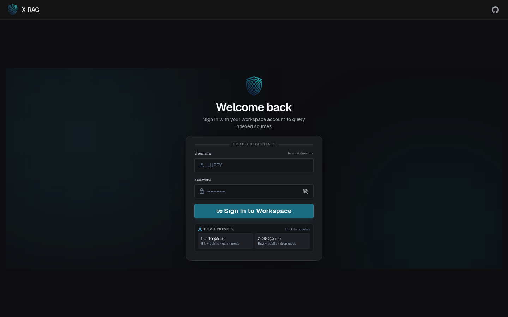
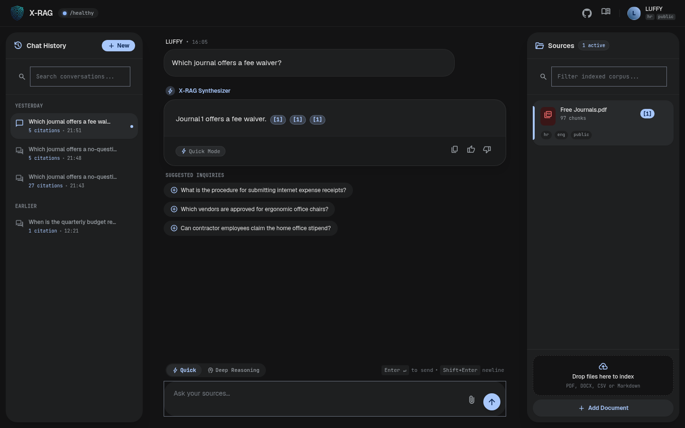

<p align="center">
  
</p>

# X-RAG

Provider-pluggable enterprise RAG: upload documents, ask questions, get answers with citations `[doc#chunk]`, and department ACL on every retrieval path.

**Stack:** FastAPI · pgvector (Supabase) or Qdrant · Jina/BGE embeddings · Groq/Ollama LLM · JWT groups (`hr` / `eng` / `public`).

---

## Contents

- [Overview](#overview)
- [Status](#status)
- [Screenshots](#screenshots)
- [Evaluation](#evaluation)
- [Quickstart](#quickstart)
- [Tutorial: your first cited answer](#tutorial-your-first-cited-answer)
- [How-to guides](#how-to-guides)
  - [Switch providers](#switch-providers)
  - [Restrict a document to a department](#restrict-a-document-to-a-department)
  - [Delete a document or a chat](#delete-a-document-or-a-chat)
  - [Run the tests](#run-the-tests)
  - [Benchmark answer quality](#benchmark-answer-quality)
  - [Use the built-in quality controls](#use-the-built-in-quality-controls)
  - [Deploy on AWS EC2 (API demo)](#deploy-on-aws-ec2-api-demo)
- [Reference](#reference)
  - [HTTP API](#http-api)
  - [CLI](#cli)
  - [Configuration](#configuration-env)
  - [Seed users](#seed-users)
  - [Citations](#citations)
- [Explanation](#explanation)
  - [The two pipelines](#about-the-two-pipelines)
  - [Access control](#about-access-control)
  - [Quick and deep modes](#about-quick-and-deep-modes)
  - [Citations as a contract](#about-citations-as-a-contract)
  - [The answer cache](#about-the-answer-cache)
  - [Provider pluggability](#about-provider-pluggability)
  - [What is deliberately left out](#about-whats-deliberately-left-out)
- [Project structure](#project-structure)
- [Logos](#logos)
- [Docs map](#docs-map)

---

## Overview

X-RAG is a provider-pluggable enterprise RAG system. Employees upload documents and chat with cited answers on company WiFi. Department isolation is enforced by ACL: HR documents stay HR-only. The same code runs fully local, behind an SSH tunnel, or online — `.env` decides at boot.

Everything is deliberately lean: no tracing stack, no separate eval dashboard. A dev-only benchmark plus runtime verification, the answer cache, and the `conversations` audit trail cover the 80% case.

---

## Status

- **Cited answers** — every claim traceable to `[doc#chunk]`; click a chip and the source row flashes.
- **Department ACL enforced before search** — HR documents never enter ENG retrieval; counts, caches, and rank positions included.
- **Quick / Deep modes** — role-defaulted, override per question (manual toggle, no classifier).
- **Provider-pluggable** — swap LLM, embeddings, reranker, vector store, or DB in one `.env`.
- **Remote primary, local fallback** — pgvector/Supabase is used when reachable; otherwise Qdrant/SQLite. Selection happens at boot (`backend/l07_storage/__init__.py`).
- **Dev-only benchmark** — 80% pass on the bundled `quantum-free-journals` set (see [Evaluation](#evaluation)).
- **Tests** — 80 unit/integration tests (`pytest`) plus a browser e2e suite (`frontend/e2e.mjs`).
- **Live AWS deployment** — Docker Compose (`xrag` + Qdrant + Caddy) on EC2, HTTPS at <https://xrag.duckdns.org>.

**Live demo:** <https://xrag.duckdns.org> · [Swagger](https://xrag.duckdns.org/docs) · [Health](https://xrag.duckdns.org/health)

> Demo only: users `LUFFY` / `ZORO`, password `password`; the corpus is a sample PDF. Do not upload confidential documents. The EC2 instance is stopped when not demoing.

---

## Screenshots

| Login | Chat with citations |
|---|---|
|  |  |

Captured from the live demo at <https://xrag.duckdns.org>. The chat view reopens a saved conversation, so no new documents or queries were added.

---

## Evaluation

The latest benchmark run scores the real pipeline on 10 questions over `Free Journals.pdf`.

| Metric | Value |
|---|---|
| **Pass rate (accuracy)** | **80%** (8/10 cases) |
| Avg latency | 7.74 s |
| p95 latency | 12.80 s |
| Faithfulness (mean) | 0.89 |
| Pass threshold | 0.60 (all enabled metrics) |
| Judge | `openai/gpt-oss-120b` (rotates 20b/120b) |
| Mode / top_k | quick / 1 |
| Groups | hr, eng, public |

Failures in that run: `scipost-core` (judge emitted invalid JSON — the answer itself was correct) and `scipost-focus` (genuine retrieval/answer miss).

Full scorecard: [`data/evaluation.md`](data/evaluation.md) · raw results: [`data/evaluation.json`](data/evaluation.json). Re-run with the [benchmark](#benchmark-answer-quality) after any model, prompt, or corpus change.

---

## Quickstart

```bash
git clone https://github.com/akashpannala/X-RAG.git
cd X-RAG

python3 -m venv .venv
.venv/bin/pip install --index-url https://download.pytorch.org/whl/cpu torch
.venv/bin/pip install -r requirements.txt
cp .env.example .env                 # fill keys / DB_URL as needed

# vector store (local default)
docker run -d --name xrag-qdrant -p 6333:6333 qdrant/qdrant

# local embeddings (only if EMBED_PROVIDER=bge)
.venv/bin/hf download BAAI/bge-m3

.venv/bin/python -m backend.run seed  # demo users
.venv/bin/python -m backend.run       # http://localhost:8001
```

The API serves the UI at `/` and Swagger at `/docs` on the same port. Health: `GET /health` → `{"status":"ok", ...}`.

For frontend-only development:

```bash
python3 frontend/serve.py 3000       # UI on :3000, API base http://localhost:8001
```

### Seed users

| Username | Password | Groups |
|---|---|---|
| `LUFFY` | `password` | hr, public |
| `ZORO` | `password` | eng, public |

### Typical API flow

1. **Login** — `POST /auth/login` → `access_token`
2. **Ingest** — `POST /ingest?allowed_groups=hr&enrich=true` with multipart field `f`
3. **Query** — `POST /query` body `{"query": "...", "top_k": 5, "mode": "quick"}` (`mode` omitted → role default)

ACL is pre-search: a user's `groups` must intersect the document's `allowed_groups` or chunks are never retrieved.

---

## Tutorial: your first cited answer

You will install X-RAG, start it, upload a document, and ask a question that comes back with a **clickable citation** — a chip you can press to see the exact source chunk highlighted in the sidebar.

You need: Python 3.11–3.13, Docker (for Qdrant), and a [Groq API key](https://console.groq.com/keys) (free tier is fine).

### 1. Install

```bash
git clone https://github.com/akashpannala/X-RAG.git
cd X-RAG
python3 -m venv .venv
.venv/bin/pip install --index-url https://download.pytorch.org/whl/cpu torch
.venv/bin/pip install -r requirements.txt
```

The torch install is CPU-only on purpose — X-RAG does not need a GPU.

### 2. Configure

```bash
cp .env.example .env
```

Paste your Groq key:

```ini
LLM_API_KEY=sk-your-groq-key
```

Leave everything else at its defaults for now — SQLite for metadata and Qdrant for vectors.

### 3. Fetch the model and start Qdrant

```bash
.venv/bin/hf download BAAI/bge-m3
docker run -d --name xrag-qdrant -p 6333:6333 qdrant/qdrant
```

### 4. Seed users and start the API

```bash
.venv/bin/python -m backend.run seed
.venv/bin/python -m backend.run
```

Verify:

```bash
curl http://localhost:8001/health
```

```json
{"status":"ok","llm":"groq","vector_store":"qdrant","qdrant":"http://localhost:6333","db":"sqlite"}
```

### 5. Open the UI

Open <http://localhost:8001> and click the **LUFFY** demo preset to log in. Or run `python3 frontend/serve.py 3000` and open <http://localhost:3000>.

### 6. Upload a document

Press the paperclip, pick the bundled `data/uploads/Free Journals.pdf`, keep the pre-checked group chips, and confirm. When ingest finishes the sources rail shows the new row — filename, chunk count, size.

### 7. Ask a question

```text
What are free journals?
```

The answer arrives with citation chips inline, and the rail marks which sources were used.

### 8. Click a citation

Press a chip in the answer. The matching row in the sources rail scrolls into view and flashes — every claim traceable to its source.

---

## How-to guides

Short, self-contained recipes. Commands assume you are at the repo root.

### Switch providers

Edit `.env`, restart the server. The boot check in the log names the failing provider immediately.

| To change | Set |
|---|---|
| LLM → local Ollama | `LLM_PROVIDER=ollama`, `LLM_BASE_URL=http://localhost:11434`, `LLM_MODEL=llama3.1:8b-q4_0` |
| LLM → hosted OpenAI | `LLM_PROVIDER=openai`, `LLM_API_KEY=sk-...` |
| Embeddings → Jina API | `EMBED_PROVIDER=jina`, `EMBED_BASE_URL=https://api.jina.ai/v1`, `EMBED_API_KEY=jina_...` |
| Reranker → Jina | `RERANK_PROVIDER=jina`, `RERANK_API_KEY=...` |
| Metadata DB → Supabase | `DB_PROVIDER=supabase`, `DB_URL=postgresql://...` (vector store follows: pgvector) |
| Vector store → Qdrant Cloud | `VECTOR_BASE_URL=https://xxx.qdrant.io`, `VECTOR_API_KEY=...` |

Switching the embedding provider changes the vector space — re-upload affected documents (same filename replaces the old vectors automatically).

### Restrict a document to a department

Via the UI: when uploading, keep only the group chips that should see the document (e.g. `hr` only).

Via the API:

```bash
curl -X POST "http://localhost:8001/ingest?allowed_groups=hr&enrich=true" \
  -H "Authorization: Bearer $TOKEN" -F "f=@policy.pdf"
```

A user whose groups do not intersect the document's `allowed_groups` will not see it in `GET /documents`, and its chunks are excluded from retrieval before search runs. See [Access control](#about-access-control).

### Delete a document or a chat

- **UI:** hover a row in the sources rail (or a chat in the history) and press the trash icon.
- **API:**

```bash
curl -X DELETE "http://localhost:8001/documents/policy.pdf" -H "Authorization: Bearer $TOKEN"
curl -X DELETE "http://localhost:8001/conversations/42" -H "Authorization: Bearer $TOKEN"
```

Deleting a document removes its vectors, BM25/SPLADE entries, metadata row, uploaded file, and invalidates the answer cache. Deletion requires group access (same ACL as reading); a non-visible document returns `404`.

### Run the tests

Unit/integration suite:

```bash
.venv/bin/python -m pytest -q
```

Browser end-to-end (needs a running backend + frontend and a Chrome on CDP port 9222):

```bash
CHROME_PATH=/path/to/chrome npx -y @accesslint/chrome@latest ensure
node frontend/e2e.mjs
```

The e2e run uploads fixture documents and asks fixture questions — clean them up afterwards (delete `vacation_e2e_*` documents and conversations matching "vacation policy").

### Benchmark answer quality

The benchmark runs a fixed question set through the real pipeline, scores every answer with DeepEval (same Groq judge as `l18_verification/eval.py`), and writes a scorecard to [`data/evaluation.md`](data/evaluation.md) plus raw results in [`data/evaluation.json`](data/evaluation.json).

```bash
# the bundled cases target the demo document "Free journals with 0 APC charges";
# upload that PDF as a public document before the first run.
# NEMO_GUARD=0 keeps the input rail's Groq calls out of the judge's rate limit.
NEMO_GUARD=0 .venv/bin/python -m backend.l18_verification.benchmark \
  --cases backend/l18_verification/benchmark_cases.json \
  --out data/evaluation.md --json-out data/evaluation.json \
  --delay 20 --top-k 3 --metrics Faithfulness
```

- The headline is **pass rate** (accuracy): a case passes when every enabled metric clears `--threshold` (default `0.6`). The report also shows per-metric means and average/p95 latency.
- `--mode quick|deep`, `--top-k`, `--groups`, `--limit`, `--threshold`, `--delay`, and `--metrics` tune the run. `--metrics Faithfulness` runs only one metric and uses far fewer judge tokens.
- The answer cache is cleared before every case; judge calls are not included in latency.
- Groq's free tier has a daily token cap (TPD). If judge calls start returning `429`, wait for the daily reset or run fewer cases with `--metrics Faithfulness`.
- For a different corpus, point `--cases` at `{"name": "...", "cases": [{"id": "...", "question": "...", "expected_output": "..."}]}`. `expected_output` enables Contextual Recall.
- Run it by hand after a model, prompt, or corpus change. It is not a service and has no dashboard or CI gate.

### Use the built-in quality controls

- **Verification pill:** every answer carries `verification.supported_ratio`; the UI shows "RAG Verified" (≥60% of claims supported by cited chunks) or "Partially Grounded". Treat a low ratio like a test failure — inspect the cited chunks, not just the prose.
- **Refusals are a feature:** "I can't answer that: low retrieval confidence" means the confidence gate fired (nothing retrievable cleared the floor). Fix it by uploading the missing document, not by rephrasing.
- **Cache-hit pill:** a repeated (or paraphrased, cosine > 0.96) question shows "Cache Hit". Ingesting or deleting any document clears the cache, so citations never go stale.
- **Audit trail:** `GET /conversations` (or the `conversations` table) shows who asked what, with which citations — enough to replay any reported bad answer alongside `data/logs/api.log`.
- **Boot checks:** if the server won't start, the log names the failing provider row (`FAIL Groq key`, `FAIL Postgres`…). Fix the env var, not the code.

### Deploy on AWS EC2 (API demo)

The reference deployment is live at <https://xrag.duckdns.org>. The AWS deployment is only a demo host. The same image runs air-gapped on a company server with `LLM_PROVIDER=ollama`, `EMBED_PROVIDER=bge`, `DB_PROVIDER=sqlite`, and local Qdrant. On AWS, `.env` points at Groq/Jina/Supabase so the API is reachable from any device.

**Stack** (`docker-compose.yml`): `xrag` (API + UI) + `qdrant` (fallback) + `caddy` (TLS). Caddy terminates HTTPS and proxies to `xrag:8001`.

| File | Purpose |
|---|---|
| `Dockerfile` | Python 3.13, CPU torch, runtime deps, non-root UID 10001 |
| `docker-entrypoint.sh` | waits for Qdrant, seeds users, starts the API |
| `docker-compose.yml` | `xrag` + `qdrant` + `caddy` |
| `Caddyfile` | HTTPS reverse proxy (200 MB uploads) |
| `deploy.env.example` | Compose variables template (`DOMAIN`, EBS paths) |
| `requirements-deploy.txt` | runtime deps (no DeepEval) |

**1. Instance** — `t3.large` (8 GiB) is the minimum for ingest/deep; `t3.xlarge` (16 GiB) if the build runs out of memory. Ubuntu 24.04, 30 GB root + 100 GB gp3 mounted at `/mnt/xrag`. The free-tier `t3.micro` (1 GiB) will OOM — use signup credits or a Spot `t3.large` instead.

**2. Security group** — inbound 443/80 from anywhere, 22 from your IP; outbound all (Groq, Jina, Supabase, Let's Encrypt).

**3. Elastic IP + DuckDNS** — point `xrag-<name>.duckdns.org` at the EIP.

**4. Install**

```bash
sudo apt-get update
sudo apt-get install -y docker.io docker-compose-v2 git
sudo fallocate -l 2G /swapfile && sudo chmod 600 /swapfile && sudo mkswap /swapfile && sudo swapon /swapfile
sudo mkdir -p /mnt/xrag/data /mnt/xrag/qdrant /mnt/xrag/models
sudo chown -R 10001:10001 /mnt/xrag/data /mnt/xrag/models   # xrag runs as UID 10001
# qdrant runs as root in its official image, so /mnt/xrag/qdrant needs no chown
git clone https://github.com/akashpannala/X-RAG.git ~/xrag
cd ~/xrag
```

**5. Environment** — copy the compose template, fill the domain, and add provider secrets to `.env`:

```bash
cp deploy.env.example deploy.env
chmod 600 .env deploy.env
```

```ini
# .env — this deployment uses the hosted providers
LLM_PROVIDER=groq
LLM_API_KEY=...
EMBED_PROVIDER=jina
EMBED_API_KEY=...
RERANK_PROVIDER=jina
RERANK_API_KEY=...
DB_PROVIDER=supabase
DB_URL=postgresql://...:5432/postgres?sslmode=require
DB_PATH=
VECTOR_BASE_URL=http://qdrant:6333
NEMO_GUARD=0
JWT_SECRET=<random-64-hex>
SEED=1
```

```ini
# deploy.env
DOMAIN=xrag-<name>.duckdns.org
XRAG_DATA_DIR=/mnt/xrag/data
QDRANT_STORAGE_DIR=/mnt/xrag/qdrant
XRAG_MODELS_DIR=/mnt/xrag/models
XRAG_PORT=8001
SEED=1
```

Use the Supabase **session pooler** on port 5432 (IPv4): host `aws-0-<region>.pooler.supabase.com`, user `postgres.<project-ref>`. The direct `db.<ref>.supabase.co` host is IPv6-only and will fail inside Docker/EC2 without IPv6.

**6. Start**

```bash
sudo docker compose --env-file deploy.env up -d --build
sudo docker compose logs -f xrag
curl -fsS https://xrag-<name>.duckdns.org/health
```

First build takes 5–10 minutes. Caddy issues the TLS certificate automatically (outbound 80/443 must stay open). Verify the EBS mounts are writable by the non-root app:

```bash
sudo docker compose exec xrag sh -c 'touch /app/data/.w /models/.w && rm /app/data/.w /models/.w && echo writable'
```

**7. Pre-warm** — open `https://xrag-<name>.duckdns.org/`, log in as `LUFFY` / `password`, and ask one deep question. The first deep query downloads the sparse/verification models (hundreds of MB); they persist in the `xrag_models` volume. Set `XRAG_MODELS_DIR=/mnt/xrag/models` to keep them on EBS.

**8. Demo (UI)** — open `https://xrag-<name>.duckdns.org/`. The PDF is gitignored, so a fresh clone does not include it: upload it through the UI (or `scp` it to `/mnt/xrag/data/uploads/`) with the group chips (`hr`, `eng`, `public`). Log in as `LUFFY` / `password`, ask a question, and click a citation chip to show the source. Toggle Quick/Deep to show both pipelines. Log in as `ZORO` (password `password`) for a second role. To demo ACL exclusion, upload the same PDF with only `hr` selected and ask as `ZORO` — it will not appear.

Stop the instance when idle (EC2 console → Stop). You pay only for EBS and the public IPv4 while stopped.

CloudFront is not needed: Caddy + Let's Encrypt already provides HTTPS, and CloudFront's 60-second origin timeout would break long ingests.

---

## Reference

Base URL: `http://localhost:8001` · Swagger UI: `/docs` · all endpoints JSON unless noted.

### HTTP API

#### Authentication

Most endpoints require `Authorization: Bearer <token>`.

| Method | Path | Body | Response | Errors |
|---|---|---|---|---|
| POST | `/auth/register` | `{"username", "password", "groups"?}` | `{"id", "username"}` | `409` duplicate or password < 8 chars |
| POST | `/auth/login` | `{"username", "password"}` | `{"access_token", "token_type":"bearer"}` | `401` bad credentials |

- Default registration group: `["public"]`. Self-registration can only assign `public`.
- Token TTL: `JWT_EXPIRE_MIN` (default 480 minutes). Payload: `sub`, `username`, `groups`, `iat`, `exp`.

#### Health

`GET /health` — no auth.

```json
{"status":"ok","llm":"groq","vector_store":"pgvector","qdrant":"http://localhost:6333","db":"postgres"}
```

#### Ingest

`POST /ingest` — multipart field `f` (the file).

| Query param | Default | Meaning |
|---|---|---|
| `allowed_groups` | `public` | comma-separated groups that may retrieve this document |
| `enrich` | `true` | run enrichment (RAPTOR-lite, hypothetical questions, NER) |

```json
{"filename":"policy.pdf","chunks":1986,"hash":"99fcdbaa8edb"}
```

- Supported extensions: `.pdf .docx .pptx .csv .md .txt .png .jpg .jpeg`; anything else → `500` with the supported list.
- Re-uploading an existing filename replaces its vectors, index entries, groups, and file (replace-on-reingest).
- Errors: `401`, `502` on LLM failure during enrichment.

#### Query

`POST /query`

```json
{"query":"What is our vacation policy?","top_k":5,"mode":"quick"}
```

| Field | Default | Notes |
|---|---|---|
| `query` | — | required |
| `top_k` | `5` | retrieval depth |
| `mode` | role default | `"quick"` or `"deep"`; default from `DEFAULT_MODE_BY_GROUP` |

```json
{
  "answer": "...Employees accrue 1.5 days per month [vacation_policy#12]...",
  "citations": ["[vacation_policy#12]", "[vacation_policy#13]"],
  "provider": "groq",
  "mode": "quick",
  "cache_hit": false,
  "verification": {"supported_ratio": 0.83}
}
```

Errors: `401`, `502` (LLM provider error).

#### Documents

`GET /documents` — list visible to the caller's groups (newest first).

```json
[{"filename":"Free Journals.pdf","chunks":81,"hash":"99fcdbaa8edb",
  "allowed_groups":["eng"],"size_bytes":69079}]
```

`size_bytes` is `null` if the file is missing on disk.

`DELETE /documents/{filename}` — removes vectors, BM25/SPLADE entries, metadata row, uploaded file, and clears the answer cache.

| Status | Meaning |
|---|---|
| `200` | `{"deleted": "<filename>"}` |
| `400` | filename contains a path separator |
| `404` | not visible to caller, or already gone (existence hidden) |
| `401` | missing/invalid token |

#### Conversations

`GET /conversations` — caller's own history, newest first, limit 100.

```json
[{"id":32,"query":"...","answer":"...","mode":"quick",
  "citations":["[doc#0]"],"created_at":"2026-09-27 16:32:38.923514"}]
```

`DELETE /conversations/{id}` — `200 {"deleted": id}`; `404` if not the caller's; `401` unauthenticated.

### CLI

| Command | Effect |
|---|---|
| `python -m backend.run` | boot checks, then serve on `HOST:PORT` |
| `python -m backend.run <port>` | serve on the given port |
| `python -m backend.run seed` | create demo users (`LUFFY`, `ZORO`), idempotent |
| `python -m backend.l18_verification.benchmark` | dev-only answer benchmark; writes `data/evaluation.md` + `data/evaluation.json` |

Exit code `1` if a configured provider fails its boot check (message names the failing row).

### Configuration (`.env`)

Single source of truth; auto-detected at boot. Template: `.env.example`.

| Variable | Default | Values / notes |
|---|---|---|
| `HOST` / `PORT` | `0.0.0.0` / `8001` | bind address |
| `CORS_ORIGINS` | `http://localhost:3000,...` | comma-separated |
| `JWT_SECRET` | `change-me-in-env` | HS256 signing key |
| `JWT_EXPIRE_MIN` | `480` | token TTL |
| `DEFAULT_MODE_BY_GROUP` | `{"hr":"quick","eng":"deep","public":"quick"}` | JSON map |
| `UPLOAD_DIR` | `data/uploads` | stored files |
| `NEMO_GUARD` | `1` | `1` enables the Nemo input rail; `0` uses the local regex screen only |
| `LLM_PROVIDER` | `groq` | `groq \| ollama \| llama.cpp \| openai \| anthropic` |
| `LLM_BASE_URL` | provider default | resolved per provider (e.g. Ollama `http://localhost:11434`) |
| `LLM_MODEL` | `openai/gpt-oss-20b` | |
| `LLM_API_KEY` | — | required for `groq/openai/anthropic` |
| `EMBED_PROVIDER` | `bge` | `bge \| jina \| voyage \| cohere \| choreo` |
| `EMBED_BASE_URL` | — | remote providers only |
| `EMBED_MODEL` | `BAAI/bge-m3` | |
| `EMBED_API_KEY` | — | remote providers only |
| `RERANK_PROVIDER` | `minilm` | `minilm \| jina \| bge` (fallback chain: configured → next → MiniLM) |
| `RERANK_BASE_URL` | `https://api.jina.ai/v1` | |
| `RERANK_MODEL` | `jina-reranker-m0` | |
| `RERANK_API_KEY` | — | required for `jina` |
| `VECTOR_BASE_URL` | `http://localhost:6333` | Qdrant |
| `VECTOR_API_KEY` | — | Qdrant Cloud |
| `VECTOR_COLLECTION` | `offline_rag` | |
| `DB_PROVIDER` | `sqlite` | `sqlite \| postgres \| supabase` |
| `DB_URL` | — | Postgres DSN; also selects pgvector as the vector store |
| `DB_PATH` | `data/meta.db` | SQLite path |

**Storage selection at boot:** pgvector if `DB_PROVIDER` is `postgres|supabase` and `DB_URL` connects; otherwise Qdrant at `VECTOR_BASE_URL`; if neither works the server refuses to start.

### Seed users

| Username | Password | Groups |
|---|---|---|
| `LUFFY` | `password` | `hr`, `public` |
| `ZORO` | `password` | `eng`, `public` |

### Citations

- Server format: `[doc#chunk]`, e.g. `[Free Journals#80]` — `doc` is the filename stem, `chunk` is 0-based.
- `citations` in responses is the list of exact tags used in `answer`.
- The frontend renders numbered chips `[1]`, `[2]`… in order of first appearance; clicking a chip flashes the matching sources-rail row.

---

## Explanation

Why the system is shaped the way it is. For commands see [How-to guides](#how-to-guides); for endpoints and env vars see [Reference](#reference).

### About the two pipelines

Everything X-RAG does is one of two pipelines.

**Ingestion** turns a file into retrievable evidence:

```text
connector → doc intelligence (Docling/OCR) → cleaning (dedup, PII redaction)
         → chunking → enrichment (summaries, hypothetical questions, entities)
         → dense embedding + sparse index → storage (pgvector/Qdrant, BM25, SPLADE, Kuzu)
```

**Querying** turns a question into a cited answer:

```text
memory rewrite → (deep: query transforms, multi-agent retrieval) → fusion + rerank
               → budgeted assembly → generation → verification → answer cache
```

The layer numbering (`l01`…`l19`) follows ingestion order; the query pipeline borrows from it. Each layer is a small package with one job, and the provider behind it is selected by `.env` — the same code runs fully local or fully hosted. Deployment topology is a configuration concern, not a code concern.

### About access control

Documents carry `allowed_groups`; users carry `groups`. A document is visible only when the two sets intersect — and the intersection is checked **before** retrieval, not after.

Post-filtering (retrieve everything, then drop what the user may not see) is the classic approach, and it is a leak vector: result counts, latencies, cache behaviour, and rank positions all still depend on documents the user must not know exist. Pre-search filtering makes the vector search itself operate on an already-authorized candidate set, so nothing downstream can leak. The cost is that filtering must be pushed into every retrieval path — dense, sparse, graph, and the answer-cache key. That is why `allowed_groups` appears in every storage signature.

Related consequences:

- `GET /documents` and `DELETE` return `404` (not `403`) for invisible documents — existence is itself information.
- Registration may self-assign only `public`; department groups are granted, never requested.
- The answer cache is keyed by groups, so a cached answer for `hr` is never served to `eng`.

### About quick and deep modes

Routing is a **manual toggle**, never an ML classifier. With exactly two modes, a learned router would add a failure mode (misclassification) without adding capacity: the user already knows whether they want a fast lookup or a thorough investigation.

- *Quick* is the default path: retrieve, rerank, generate. Optimised for latency.
- *Deep* adds query rewriting (multi-query, step-back, HyDE), parallel agents (vector, graph, SQL, image where available), and a heavier verification pass.

Roles get sensible defaults through `DEFAULT_MODE_BY_GROUP` (`eng` starts in deep, everyone else in quick), which the user can override per question. The default exists so the toggle starts in the right position, not so it can be ignored.

### About citations as a contract

The generator is instructed to repeat the exact retrieval tags (`[name#chunk]`) inside its answer text. Those tags are the contract between generation and presentation:

- The server returns the raw tags in `citations`.
- The frontend parses the answer body, converts tags into numbered chips, and maps chip → document stem for the sources-rail flash.

If the model emits a placeholder (`[doc#3]`) or echoes the instruction (`[doc#chunk]`), the parser resolves or strips it rather than trusting the model to be consistent — the model is the weakest link in any citation scheme, so the parser assumes the tag is a hint, not a promise. Chunk ids are 0-based positions within a document's chunk list; they are stable only while the document is not re-ingested (re-ingest replaces chunks and therefore ids).

### About the answer cache

Repeated questions are expensive: retrieval, rerank, generation, verification. The cache stores answers keyed by query, mode, and groups, and serves a hit when a new query is a semantic near-duplicate of a stored one (cosine > 0.96 against cached queries — a threshold, not a string match, so "what is RSI?" and "what does RSI mean?" share an answer).

Cache entries are invalidated by anything that changes the evidence: ingesting a document clears it, deleting a document clears it. A stale citation is worse than a slow answer, so the cache errs toward invalidation.

### About provider pluggability

One `.env` decides LLM, embeddings, reranker, vector store, and metadata DB. At boot the server runs `check_requirements()`: it probes only the *configured* providers and refuses to start if one fails — checks only, never installs, never silently substitutes. The rerank step is the one place with an explicit fallback chain (configured provider → BGE → MiniLM) because reranking is quality-degrading but non-fatal if degraded; everything else fails loudly instead.

Storage is the one exception with a topology fallback: pgvector/Supabase is preferred when configured and reachable, Qdrant is the local fallback. The choice is made once at boot; an empty-but-reachable primary is not treated as a failure.

### About what's deliberately left out

Three workstreams were considered and cut: offline evaluation (the spec's removed L21), full observability, and heavyweight guardrails. Each was rejected for the same reason — weight disproportionate to the current scope — and each already has a thin slice covering the 80% case.

**Evaluation.** A real eval harness means a golden question set, retrieval metrics (recall@k, MRR), answer metrics (faithfulness, citation precision), and a regression runner someone maintains on every model or prompt change. That is a second product, not a feature. What exists instead: per-answer runtime verification (`l18_verification` — CoVe-lite checks plus an LLM judge pass, surfaced as the "RAG Verified / Partially Grounded" pill with a supported ratio), a dev-only benchmark (`backend/l18_verification/benchmark.py`) that runs a bundled question set through the real pipeline and writes a pass-rate/latency scorecard to `data/evaluation.md`, plus 80 unit/integration tests and a browser suite pinning current behavior. Build the full harness (retrieval recall@k, MRR, a CI regression runner) when answers start changing for reasons nobody can explain — that is the signal the thin slice stopped being enough.

**Observability.** Full tracing (per-request stage timings, token/cost accounting, dashboards, alerting) needs infrastructure that costs more attention than the app it watches at this scale. What exists instead: rotating file logs (`data/logs/api.log`), the `/health` endpoint (provider, vector store, DB in one JSON), the answer cache as a query log, and the `conversations` table (who asked what, when, with which citations — a usable audit trail). When a user reports a bad answer, that trail plus the log is enough to replay it.

**Guardrails.** Output moderation models, toxicity classifiers, and rate limiters add a network hop and a failure mode to every request. What exists instead: an optional Nemo input rail plus a local prompt-injection screen and a retrieval-confidence gate (`l14_security/injection.py` — weak retrieval refuses to answer rather than hallucinating), PII redaction at ingest (Presidio), pre-search ACL on every path, and JWT auth with server-side user re-checks. The philosophy: refuse loudly at the weakest link (empty context, obvious injection) rather than scoring everything.

---

## Project structure

```text
backend/
  l01_connectors/     local loaders (PDF/DOCX/PPTX/CSV/MD/images)
  l02_docintel/       Docling + RapidOCR fallback
  l03_cleaning/       MinHash dedup + Presidio PII
  l04_chunking/       8 chunking strategies
  l05_enrichment/     RAPTOR-lite + hypothetical questions + NER
  l06_embedding/      dense embeddings (BGE/Jina/Voyage/Cohere)
  L06_sparse/         BM25S + SPLADE-v3 (gated)
  l07_storage/        pgvector (primary) / Qdrant (fallback) + Kuzu
  l08_freshness/      sha256 + meta DB (users/documents/conversations)
  l09_toggle/         quick/deep mode
  l10_memory/         conversation memory rewrite
  l11_transforms/     multi-query, step-back, HyDE
  l12_agents/         vector/graph/SQL/image retrieval agents
  l13_rerank/         RRF + MiniLM + Jina/BGE fallback + RankGPT + MMR
  l14_security/       JWT, ACL, injection screen, Nemo rail
  l15_compression/    extractive budget optimizer
  l16_assembly/       prompt assembly + citation tags
  l17_generation/     Self-RAG/CRAG generation + answer()
  l18_verification/   CoVe-lite verification + dev benchmark
  l19_cache/          answer cache (cosine > 0.96) + LRU
  run.py              boot checks → serve / seed
frontend/             static UI (index.html, chat.html, app.js, e2e.mjs)
data/                 uploads, indexes, logs, evaluation artifacts
tests/                pytest suite
Dockerfile            API image (CPU torch, non-root UID 10001)
docker-compose.yml    xrag + qdrant + caddy
Caddyfile             HTTPS reverse proxy for the AWS demo
deploy.env.example    Compose variables template (DOMAIN, EBS paths)
LICENSE               MIT
screenshots/          README reference captures (login, chat)
SPEC.md               product spec as a completion checklist
```

---

## Logos

| File | Use |
|------|-----|
| `banner.png` | Wide wordmark (README header) |
| `logo.png` | Shield mark (compact / avatar) |

The UI keeps its own copies under `frontend/assets/` (`logo-long.png`, `logo-short.png`) because it is served from the `frontend/` directory.

---

## Docs map

| Kind | Where |
|---|---|
| Full documentation (this file) | `README.md` |
| Product spec / completion checklist | [SPEC.md](SPEC.md) |
| Latest benchmark scorecard | [data/evaluation.md](data/evaluation.md) · raw [data/evaluation.json](data/evaluation.json) |
| Interactive API | `/docs` on a running server |
| Config template | [.env.example](.env.example) |
| Compose template | [deploy.env.example](deploy.env.example) |
| Browser e2e | [frontend/e2e.mjs](frontend/e2e.mjs) |
| License | [MIT](LICENSE) |
